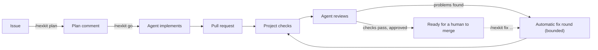

# NexKit

**Turn GitHub issues into reviewed, tested pull requests with coding agents.**

NexKit is a GitHub Actions pipeline plus a Claude Code plugin. A collaborator asks for a
plan on an issue, approves it, and NexKit implements the change on a branch, runs the
project's checks, has a separate agent session review the result and opens a pull
request. A person decides whether to merge.



## Supported versions

Everything the pipeline installs is pinned to the version NexKit was tested with, so a
release never changes underneath you. New agent versions still arrive quickly: a weekly
job proposes the newest stable version of each runtime, CI tests it with the real CLI, and
a new NexKit release ships it.

| Dependency | Supported | Tested |
|---|---|---|
| Platform | GitHub and GitHub Actions | |
| Runner | GitHub-hosted `ubuntu-24.04` | `ubuntu-24.04` |
| Claude Code | the version pinned in [`nexkit/__init__.py`](nexkit/__init__.py), installed by the pipeline | that version, with a live smoke test |
| Python for NexKit in the pipeline | 3.12, installed without changing your project's Python | 3.12 |
| Python for the `nexkit` CLI on your machine | 3.12 or newer | 3.12 |

Your project's own commands (`setup`, `checks`) use whatever tools they install on
`ubuntu-24.04`.

## What you need

- A GitHub repository with a test or lint command that can run on `ubuntu-24.04`.
- A credential for each agent, stored as a repository secret that `.nexkit/config.json`
  names. `nexkit init` declares one agent, `claude`: Claude Code with a Claude Pro or Max
  subscription token from `claude setup-token` in `CLAUDE_CODE_OAUTH_TOKEN`; an Anthropic
  API key works too.
- Optionally, more agents for some stages, such as a second Claude account or an API key
  that takes over at a usage limit (see [Agents](docs/configuration.md#agents)). Claude
  Code is the one runtime NexKit supports and tests today.
- No server or self-hosted runner. Everything runs on GitHub-hosted runners, which are
  free for public repositories.

## Set up a repository

### With Claude Code

Install the plugin once:

```text
/plugin marketplace add phuongnse/nexkit
/plugin install nexkit@nexkit
```

Then open Claude Code in your repository and run `/nexkit:setup`. It finds your test
commands, writes the two NexKit files, helps you add the secret and runs `nexkit doctor`.

### By hand

```sh
pipx install git+https://github.com/phuongnse/nexkit@v4.7.0   # or run bin/nexkit from a clone
cd your-repository
nexkit init --check "test=npm test" --check "lint=npm run lint" --setup "npm ci"
claude setup-token                       # copy the token it prints
gh secret set CLAUDE_CODE_OAUTH_TOKEN    # paste it when asked
gh api -X PUT repos/OWNER/REPO/actions/permissions/workflow \
  -f default_workflow_permissions=read -F can_approve_pull_request_reviews=true
git add .nexkit .github/workflows/nexkit.yml && git commit -m "Add NexKit" && git push
nexkit doctor
```

With an Anthropic API key instead, run `gh secret set ANTHROPIC_API_KEY` and change
`oauth_token_secret` to `"api_key_secret": "ANTHROPIC_API_KEY"` in `.nexkit/config.json`.
The workflow that `nexkit init` writes passes the pipeline `secrets: inherit`, so it can
read each secret by the name the configuration gives it.

The workflow must be on the default branch, because GitHub only runs comment-triggered
workflows from there.

## Use it

| Where | Comment | What happens |
|---|---|---|
| Issue | `/nexkit plan [notes]` | The agent reads the code and posts a plan for you to approve: what changes, the decisions it made, risks and acceptance criteria, with the implementation notes collapsed. Run it again after answering questions or asking for changes: it revises the latest plan and says what changed. |
| Issue | `/nexkit go [notes]` | The agent implements the latest plan. NexKit opens a pull request, runs the checks and reviews it. |
| NexKit PR | `/nexkit fix [instructions]` | Another implementation round using the failing checks, review findings and your instructions. When the pull request conflicts with its base branch, the round merges the base branch and resolves the conflicts, or asks you to decide the ones that need a choice. |
| NexKit PR | `/nexkit review` | Re-run the checks and the AI review, for example after you pushed a commit. |
| NexKit PR | *Request changes* review | Same as `/nexkit fix`, with your review as the instructions. |

Only people with write access can run commands. When checks fail or the review finds a
blocking problem, NexKit starts up to `fix.max_auto_rounds` repair rounds by itself
(default 2), then stops and asks for a person. Each run gets its own NexKit comment right
after the command, with a link to its log: it shows the run in progress, then its result,
the tokens its agents used and the next step. Pull requests also get `nexkit/checks` and
`nexkit/review` commit statuses, which you can make required in branch protection.

Merging is up to you unless you set `"merge": {"auto": true}`. NexKit then merges approved
pull requests itself, closes their issues and can start your CI on the base branch
afterwards; see [Automatic merge](docs/configuration.md#automatic-merge). With
`"conflicts": {"auto_resolve": true}` it also merges the base branch into its pull requests
that start to conflict. When an agent hits its account's usage limit, NexKit moves the
stage to the agent's [fallback agents](docs/configuration.md#fallback-agents), if it has
any, or pauses and continues after the reset.

With `"autopilot": {"enabled": true}`, nobody needs to post the commands: NexKit plans each
ready issue of the current milestone, or of every milestone with `"scope": null`, starts `/nexkit go` on a plan that needs nobody and
moves on when an issue closes, driven by GitHub events. It stops where a person is
needed, such as a plan with questions; see [Autopilot](docs/configuration.md#autopilot).

## Local commands

| Command | What it does |
|---|---|
| `nexkit init` | Writes `.nexkit/config.json` and `.github/workflows/nexkit.yml`. |
| `nexkit doctor` | Checks the repository's setup: config, workflow triggers and NexKit ref, each agent's secrets and that the workflow passes them, permissions. Mentions a newer NexKit release. |
| `nexkit status [--json]` | Lists the open NexKit issues and pull requests with what each waits for and a link to its last run, recent merges by NexKit, the items that need a person and why, and with autopilot what its next sweep does with each issue in scope. It reads NexKit's hidden markers and changes nothing. |

The commands use the GitHub CLI's login (`gh auth login`) or `GITHUB_TOKEN`.

## Configuration

`.nexkit/config.json`, written by `nexkit init`:

```json
{
  "version": 1,
  "agents": {
    "claude": {"runtime": "claude-code", "provider": "anthropic", "oauth_token_secret": "CLAUDE_CODE_OAUTH_TOKEN"}
  },
  "agent": "claude",
  "model": "sonnet",
  "setup": ["npm ci"],
  "checks": [
    {"name": "test", "run": "npm test"},
    {"name": "lint", "run": "npm run lint"}
  ],
  "fix": {"max_auto_rounds": 2},
  "merge": {"auto": false}
}
```

Agents, models, time and cost limits can be set per stage, and per profile: a triage step
reads each issue and picks a profile, so hard issues get stronger models than easy ones.
Caches that your CI saves on the default branch can be restored before `setup`. See the
[configuration reference](docs/configuration.md).

## Learn more

- [How it works](docs/how-it-works.md): jobs, permissions, state and failure handling.
- [Configuration reference](docs/configuration.md)
- [Troubleshooting](docs/troubleshooting.md)
- [Changelog](CHANGELOG.md)

## Develop NexKit

Python 3.12 or newer, standard library only. [AGENTS.md](AGENTS.md) has the code layout,
the rules to keep and the commands that verify a change. The live smoke test
(`scripts/smoke.py`) costs a few cents and needs a Claude login.

## License

[MIT](LICENSE)
