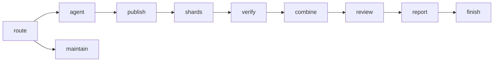
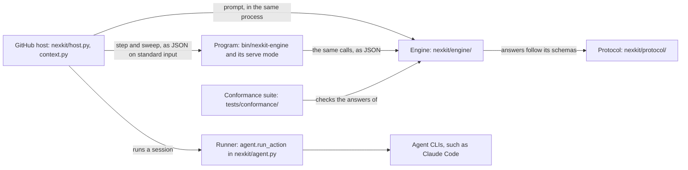

# Architecture

This page explains how NexKit is built, for the people and agents who change it. It names the
package and its modules, the reusable workflow and its jobs, the tokens and secrets each job
holds, where state lives, the engine and its hosts, and the plugin. A *job* is one unit of a
GitHub Actions workflow. The *App* is the GitHub App that a repository installs for NexKit, and
everything the pipeline writes on GitHub, it writes as the App. To learn what NexKit does on a
repository, read [How it works](how-it-works.md) first. This page says how the parts fit.

## The package

The package `nexkit/` holds everything NexKit runs. It uses the Python standard library only, and
it needs Python 3.12 or later. Two commands run it. `bin/nexkit` runs every command, both the ones
a person runs on a computer and the ones that each pipeline job runs. `bin/nexkit-engine` runs the
engine's calls as a program that reads JSON on standard input.

| Module | Purpose |
|---|---|
| `__init__.py` | Version and pins |
| `__main__.py` | Runs `cli.py`, so that `python3 -m nexkit` works |
| `cli.py` | Every command, local and pipeline |
| `route.py` | `route`: event → action, authorization, `verified_sha` |
| `context.py`, `evidence.py`, `agent.py` | `agent` and `review`: the fetched inputs, the prompt request, CI evidence, agent run, patch |
| `publish.py` | `publish`: plan comment, commit, push, pull request, and the store of a round's results in the item's state |
| `checks.py`, `cache.py` | Setup and checks; the keys of cache restore |
| `report.py` | `report`: statuses, reviews, run and state comments, and what happens next |
| `state.py` | Pipeline state, kept in comments that the App writes |
| `progress.py` | Each run in its own comment, posted where the run started |
| `refusal.py` | Why GitHub refused a merge, and what a person does about it |
| `item_state.py`, `first_state.py` | Work items' state documents, in App comments, with the cursor of what the host took; the first one, from NexKit 6's markers |
| `host.py`, `program.py` | The GitHub host's calls of the engine's `step` and `sweep`, and its taking of an item's events from their sources; the client that runs the engine program for them |
| `maintain.py`, `usage.py`, `autopilot.py` | Work after other events; runs paused at a usage limit; autopilot sweeps |
| `config.py`, `globs.py`, `scaffold.py`, `app.py` | Config schema and path globs; `nexkit init` and `doctor`; the GitHub App |
| `status.py`, `snapshot.py`, `pin.py`, `github.py`, `gitutil.py` | `nexkit status` and its batched reads; the pinned release; REST, GraphQL and git helpers |
| `schema.py`, `redact.py`, `runlog.py`, `textutil.py` | Result validation, secret removal, run log; the text limits and shortening that the host and the engine share |
| `runtimes/` | Everything specific to one CLI or provider |
| `protocol/` | The engine's protocol as JSON Schemas, with examples; `size.py` bounds its state document; `keys.py` converts keys between the protocol's camelCase and snake_case; `stages.py` holds each stage's run state, access, inputs and diff limit |
| `engine/` | The engine: states and moves in `machine.py`; prompts in `prompt.py` and `prompts/`; `sweep.py` (starts); `cli.py` and `__main__.py` (`nexkit-engine`) and `serve.py` |
| `templates/` | The caller workflow that `nexkit init` installs in a repository |

`scripts/` holds the scripts that maintain NexKit itself:

| Script | Purpose |
|---|---|
| `smoke.py` | The smoke test: every agent stage against a real agent runtime |
| `agent_version.py` | Shows or updates the pin of each agent runtime, for `update-agents.yml` |
| `image_digest.py` | Shows or updates the pin of the image's base, for `update-image.yml` |
| `release_notes.py` | Prints a version's release notes |
| `docs_audit.py` | The docs audit: reads the docs against the code and turns findings into issues |
| `conformance.py` | Writes the engine's conformance suite as one file, and plays it against an engine |
| `protocol_freeze.py` | Copies the protocol's schemas to `tests/golden/protocol/`, for a test |
| `lint.sh` | ruff and actionlint at their pins |

`tests/` holds the checks that [Testing](testing.md) describes.

The reasons for the package's use of the standard library only are in
[D8](decisions/d8-standard-library-only.md).

## The workflows and their jobs

Each repository that uses NexKit runs one caller workflow, `nexkit/templates/workflow.yml`, which
`nexkit init` installs as `.github/workflows/nexkit.yml`. Its `item` job names the work item that
an event belongs to: an issue with its NexKit pull request, or a person's pull request. It runs
NexKit's code with no App key and no checkout of the repository, and it reads only numbers and
branch names. Its `nexkit` job calls [`pipeline.yml`](../.github/workflows/pipeline.yml), NexKit's
reusable workflow. The `nexkit` job's concurrency group uses the item that `item` names, so one run
at a time works on each item, as [One run at a time](how-it-works.md#one-run-at-a-time) describes.

`pipeline.yml` runs the jobs of one run. Its `agent` and `review` jobs run in two workflows of
their own, `pipeline-agent.yml` and `pipeline-review.yml`. GitHub gives a job that reads a secret by
a name known only at run time every secret on its runner. So `pipeline.yml` reads the agents'
secrets in its call to those two workflows, off the runner, and passes them as numbered slots.
[Tokens and secrets](#tokens-and-secrets) says which job holds what.

The diagram shows the jobs of one run. Each arrow means that the job after it waits for the job
before it. `report` also waits for every job before it, and `finish` runs only when `report` did
not finish. `maintain` is not part of a round. It waits for `route` only, and it runs
for events that are not commands. `route` also starts each run in an item's concurrency group by
taking the item's waiting events from their sources (`host.take`), so every job waits for that
first. With `parallel_checks`, one `verify` job runs for each check
job, all at once. Jobs that do not apply to a command are skipped. What each job does is in
[One run, ten jobs](how-it-works.md#one-run-ten-jobs).

## Tokens and secrets

This section says which token and which secrets each job holds, and why. A job that runs an agent
or repository code must hold no write token and no App key. So a mistake in an agent's session, or
in the repository's code, cannot write to GitHub or read the App's key. Every other job holds only
what it needs. The table lists each job of the three pipeline workflows. Its *Job token* column is
the job's `permissions:`, which the job's `GITHUB_TOKEN` gets. Its *App token* column is the
permissions the job asks the App for when it mints a token.

| Workflow | Job | Job token | App token | Secrets |
|---|---|---|---|---|
| `pipeline.yml` | `route` | `contents: read` | `actions: read`, `contents: read`, `issues: write`, `pull-requests: write`, `statuses: write` | The App's id and key, which `github_app` names |
| `pipeline.yml` | `agent` | `actions: read`, `checks: read`, `contents: read`, `issues: read`, `pull-requests: read` | none | The agents' secret slots, `AGENT_SECRET_1` to `AGENT_SECRET_8` |
| `pipeline.yml` | `publish` | `contents: read` | `contents: write`, `issues: write`, `pull-requests: write`, `workflows: write` | The App's id and key, which `github_app` names |
| `pipeline.yml` | `shards` | `contents: read` | none | none |
| `pipeline.yml` | `verify` | `contents: read` | none | none |
| `pipeline.yml` | `combine` | `actions: read`, `contents: read` | none | none |
| `pipeline.yml` | `review` | `contents: read`, `issues: read`, `pull-requests: read` | none | The agents' secret slots, `AGENT_SECRET_1` to `AGENT_SECRET_8` |
| `pipeline.yml` | `report` | `contents: read` | `actions: write`, `checks: read`, `contents: write`, `issues: write`, `pull-requests: write`, `statuses: write`, `workflows: write` | The App's id and key, which `github_app` names |
| `pipeline.yml` | `maintain` | `contents: read`, `issues: read`, `pull-requests: read` | `actions: write`, `checks: read`, `contents: write`, `issues: write`, `pull-requests: write`, `statuses: write`, `workflows: write`, `vulnerability-alerts: read` | The App's id and key, which `github_app` names |
| `pipeline.yml` | `finish` | `contents: read` | `actions: write` | The App's id and key, which `github_app` names |
| `pipeline-agent.yml` | `agent` | `actions: read`, `checks: read`, `contents: read`, `issues: read`, `pull-requests: read` | none | The agents' secret slots, `AGENT_SECRET_1` to `AGENT_SECRET_8` |
| `pipeline-review.yml` | `review` | `contents: read`, `issues: read`, `pull-requests: read` | none | The agents' secret slots, `AGENT_SECRET_1` to `AGENT_SECRET_8` |

The `maintain` job mints a second token, with `vulnerability-alerts: read` to read Dependabot
alerts. That token exists only with `autopilot.dependabot`, and only for an autopilot sweep. Which
secrets a run reads is in [Settings and secrets](configuration.md#settings-and-secrets).

The agent does not commit or push. It edits the working tree, and `publish` turns those edits into
a commit. Several rules follow from that:

- The session that runs the agent holds only a read-only token, and it never holds a token that
  can write to the repository.
- Jobs that hold write tokens never run code from the repository or from the agent.
- Each job that writes mints its own token from the App, with only the permissions it needs. Only
  the step that mints the token gets the App's key, and the token expires within an hour.
- `maintain` waits for paused commands with its read-only token, and it mints the App's token
  after the wait, so the token lasts for the work.
- The jobs that write read only the App's key, and they run only NexKit, so nothing else on their
  runner reads the rest of the secrets. The `agent` and `review` jobs must not read secrets by a
  name known only at run time. They are workflows of their own, and `pipeline.yml` fills their
  numbered slots in its call.
- Checks run in a job with no secrets at all, and so does each of the parallel check jobs.
- Jobs that run the agent's code restore caches but never save one, so nothing they produce
  reaches later runs.
- `report` needs `contents: write` only to merge when `merge.auto` is on. Its token holds that
  permission in every run, but it never pushes, and with `merge.auto: false` it never merges.

The reasons for the rule that the agent's session never holds a write token are in
[D3](decisions/d3-agent-jobs-hold-no-write-token.md).

## State

NexKit keeps no state outside GitHub. A run can start again, or start beside another run, so the state
of each work item must sit where every run reads it. All of it is on GitHub: in comments on the
issue and the pull request, in commit statuses, and in the Actions artifacts of NexKit's own runs,
which can expire. [How it works](how-it-works.md#state) says what
each comment holds, and [the state document](engine.md#the-state-document) describes the state the
engine decides from.

Three modules read and write it. `state.py` keeps the pipeline's state in the App's comments,
`item_state.py` keeps each work item's state document in one App comment, together with the cursor
that names the newest source the host took from GitHub, and `first_state.py` reads the first state
document from NexKit 6's markers. `progress.py` writes the pipeline's state comment only on the
state its writer read, and `autopilot.py` does the same for autopilot's record comment. `host.py`
stores an open item's first import, takes its events from their sources after that cursor and
stores the engine's answers through `item_state.py`.

## The engine and its hosts

The engine decides what happens to a work item, and a host carries those decisions out. The GitHub
host, `nexkit/host.py`, stores the work and its state on GitHub, sends events to the engine, carries
out the engine's answers and tells people. [The engine](engine.md) describes the whole design, and
the note under its title tells what is built.

The engine answers three calls: `step` decides what happens to one work item, `prompt` writes a
stage's prompt from the texts the host fetched, and `sweep` chooses which waiting items start. [The
engine](engine.md#the-engine) defines each call. The GitHub host gets its `step` and `sweep` answers
from the engine program. `host.step` and the sweep send one JSON request through `nexkit/program.py`,
which runs `python -P -m nexkit.engine <call>` with the host's own Python and the same installed
package. The program's environment holds only `PATH`, `PYTHONPATH` and `LANG`, so no token or secret
of the job reaches it, and `-P` keeps the working folder, which may hold a repository's code, off its
import path. A program that is missing, crashes or runs past its timeout counts as an engine refusal:
the item waits for a person, as it does when the engine itself refuses. The GitHub host still calls
`prompt` in the same process, as a Python function. It sends only some of its decisions to `step`, and
[getting there](engine.md#getting-there) lists them.

The `nexkit-engine` program runs the same calls for a host that reads JSON, one request on standard
input and one answer on standard output. `nexkit-engine serve` answers the same calls over HTTP. The
GitHub host runs only the program, and only for `step` and `sweep`. The protocol, in `nexkit/protocol/`, holds the JSON Schemas of the events,
actions and state that pass between a host and the engine. The conformance suite in
`tests/conformance/` holds cases, each an event with the answers it must give, and checks the engine
against them. `scripts/conformance.py` can also write the suite as one file for other engines and
hosts, as [Conformance](engine.md#conformance) says.

A runner runs one agent session for one stage. For agent CLIs such as Claude Code, the runner is
`agent.run_action` in `nexkit/agent.py`.

[The parts](engine.md#the-parts) lists each part and where it lives. [Hosts](engine-hosts.md#hosts)
compares the GitHub host with the other hosts that the design names.

The reasons for splitting the engine from its hosts are in
[D10](decisions/d10-an-engine-decides-hosts-carry-out.md).

## The plugin

The plugin lets a person set up NexKit and work with it from Claude Code. Its manifests are
`.claude-plugin/plugin.json` and `.claude-plugin/marketplace.json`. Its skills, under `skills/`,
carry out the tasks that [How it works](how-it-works.md) describes:

- [`setup`](../skills/setup/SKILL.md) sets NexKit up on a repository.
- [`request`](../skills/request/SKILL.md) writes issues for NexKit.
- [`status`](../skills/status/SKILL.md) says what NexKit is doing on a repository.

The maintenance skills under `.claude/skills/` serve work on NexKit itself. For example,
[`nexkit-docs-audit`](../.claude/skills/nexkit-docs-audit/SKILL.md) reads the docs against the
code, and [`nexkit-maintain`](../.claude/skills/nexkit-maintain/SKILL.md) carries out the owner's
session on this repository as [Delivery](delivery.md) describes. `claude plugin validate --strict .`
checks the manifests and the skills, as [the checks](testing.md#which-check-covers-what) say.
